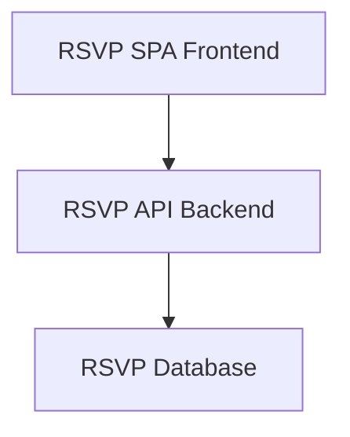
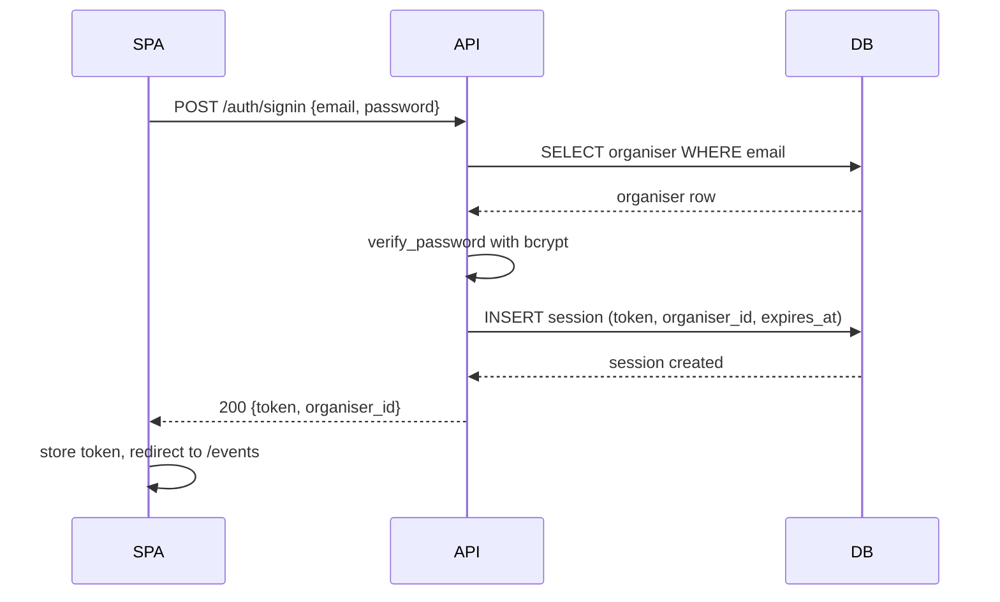
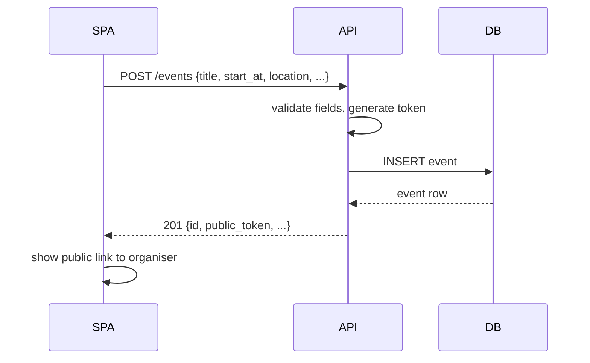
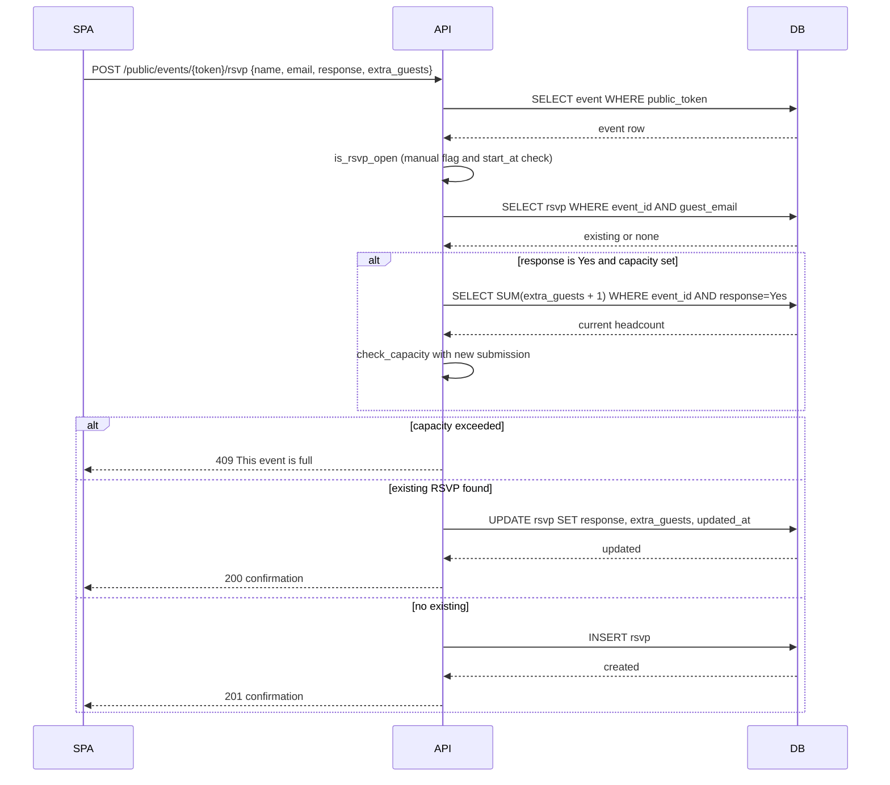
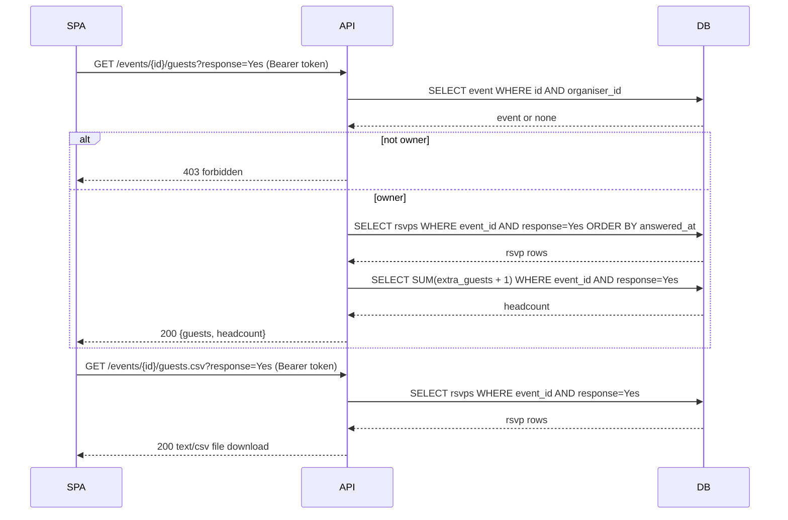
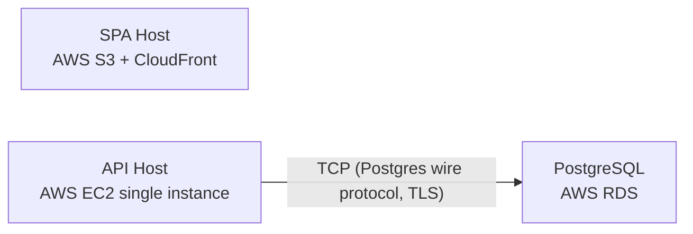

# Architecture

> Maintained by QuorQ AI SDLC. Text between `sdlc:auto` markers is regenerated; anything outside them is yours and is kept.

<!-- sdlc:auto:start narrative -->
## Overview

### ARCH-OVERVIEW · approved · source: architecture:v4

Event RSVP is a lightweight single-page application where organisers sign up, create events with hard-to-guess public links, and track guest RSVPs, while guests submit responses without creating accounts. The architecture uses a React 19 SPA served from a static host and a FastAPI 0.115 REST API served from a separate application host, both backed by a managed PostgreSQL 16 database. Authentication uses opaque server-side session tokens sent as Bearer headers, enabling sign-out revocation. The design covers event CRUD, public RSVP submission with email-based deduplication and capacity enforcement, manual and automatic RSVP closing, a filterable guest list with headcount, and CSV export.

Architecture version 4, status approved. Three-tier architecture: SPA frontend (React 19), REST API backend (FastAPI 0.115), and relational database (PostgreSQL 16). Authentication model: opaque server-side session tokens returned in response body, stored client-side, sent as Bearer header on protected requests; sessions are revocable for sign-out. Public RSVP flow requires no authentication—guests access events via cryptographically random public tokens.

**Related:** FR-1, FR-2, FR-3, FR-4, FR-5, FR-6, FR-7, FR-8

### ARCH-SPA · approved · source: architecture:v4

The RSVP SPA Frontend (React 19) renders organiser screens (sign-up, sign-in, events list, event editor, guest list) and the public event page with RSVP form. It stores the bearer token client-side and sends it on protected requests, reading the API base URL from VITE_API_BASE_URL.

Component name: RSVP SPA Frontend. Technology: React 19. Responsibilities: Render organiser screens (sign-up, sign-in, events list, event editor, guest list) and the public event page with RSVP form. Token management: stores bearer token client-side, sends it as Bearer header on protected requests. Configuration: reads API base URL from VITE_API_BASE_URL environment variable. Deployment target: AWS S3 + CloudFront (static file hosting).

**Related:** FR-1, FR-2, FR-3, FR-4, FR-5

### ARCH-API · approved · source: architecture:v4

The RSVP API Backend (FastAPI 0.115) provides REST endpoints for organiser authentication, event CRUD with ownership checks, public event retrieval by token, RSVP submission with deduplication and capacity enforcement, RSVP open/close control, guest list retrieval with filtering, and CSV export.

Component name: RSVP API Backend. Technology: FastAPI 0.115. Responsibilities: (1) Organiser authentication: sign-up, sign-in, sign-out with server-side session tokens. (2) Event CRUD with ownership checks. (3) Public event retrieval by token. (4) RSVP submission with deduplication (unique constraint on event_id + guest_email) and capacity enforcement. (5) RSVP open/close control. (6) Guest list retrieval with response-type filtering. (7) CSV export of filtered guest list. Deployment target: AWS EC2 single instance, Python 3.12 / uvicorn.

**Related:** FR-1, FR-2, FR-3, FR-4, FR-5, FR-6, FR-7, FR-8

### ARCH-DB · approved · source: architecture:v4

The RSVP Database (PostgreSQL 16) stores organisers, sessions, events, and RSVPs with a unique constraint on (event_id, guest_email) for deduplication. It supports capacity headcount queries.

Component name: RSVP Database. Technology: PostgreSQL 16. Deployment target: AWS RDS (managed, provides encryption and backups). Key constraint: unique constraint on (event_id, guest_email) to enforce RSVP deduplication. Supports SQL count queries for capacity headcount calculations. Entities stored: organisers, sessions, events, rsvps.

**Related:** FR-6, FR-7

### ARCH-CRITICAL-PATHS · approved · source: architecture:v4

Four critical paths are defined: organiser sign-in, event creation with public link, RSVP submission with capacity check, and guest list with filter and CSV export.

Critical Path 1 — Organiser Sign-In: Organiser submits email and password; backend verifies bcrypt hash; creates a session row with an opaque token; returns token in response body; SPA stores it and sends as Bearer header on protected requests.

Critical Path 2 — Create Event with Public Link: Authenticated organiser submits event details; backend validates fields; generates a cryptographically random public token; persists the event; returns it with the public link.

Critical Path 3 — Submit or Update RSVP with Capacity Check: Guest submits RSVP via public link; backend checks if RSVPs are open; looks up existing RSVP by (event_id, email); checks capacity for Yes answers; either inserts, updates, or refuses with a clear message.

Critical Path 4 — Guest List with Filter and CSV Export: Organiser requests guest list for one of their events, optionally filtered by response type; backend verifies ownership; returns list with headcount; can produce CSV download of the filtered set.

**Related:** FR-1, FR-2, FR-5, FR-6, FR-7

### ARCH-ENTITIES · approved · source: architecture:v4

Four entities are defined: organisers, sessions, events, and rsvps. The events entity includes a public_token for hard-to-guess links and an rsvps_open flag for manual/automatic closing.

Entity: organisers — Fields: id, email, password_hash, created_at.

Entity: sessions — Fields: id, organiser_id, token, created_at, expires_at, revoked.

Entity: events — Fields: id, organiser_id, title, description, start_at, location, capacity, public_token, rsvps_open, created_at, updated_at.

Entity: rsvps — Fields: id, event_id, guest_name, guest_email, response, extra_guests, answered_at, updated_at.

Key constraint: unique on (event_id, guest_email) for RSVP deduplication.

**Related:** FR-1, FR-2, FR-5, FR-6

### ARCH-ENDPOINTS · approved · source: architecture:v4

Twelve REST endpoints are defined covering authentication, event CRUD, RSVP status control, guest list retrieval, CSV export, public event retrieval, and public RSVP submission.

Authentication endpoints:
- POST /auth/signup — Create an organiser account with email and password (min 8 chars), return session token.
- POST /auth/signin — Sign in with email and password, return session token.
- POST /auth/signout — Revoke the current session token.

Event management endpoints (authenticated, ownership-checked):
- GET /events — List the organiser's events ordered upcoming first then past, with Yes/No/Maybe counts.
- POST /events — Create a new event with title, description, start_at, location, optional capacity.
- GET /events/{event_id} — Get details of an own event.
- PUT /events/{event_id} — Update any field of an own event.
- DELETE /events/{event_id} — Delete an own event and all its RSVPs.
- PATCH /events/{event_id}/rsvp-status — Close or reopen RSVPs for an own event. Reopen is refused if start_at has passed.

Guest list endpoints (authenticated, ownership-checked):
- GET /events/{event_id}/guests — Get the guest list for an own event, optionally filtered by response, with total headcount.
- GET /events/{event_id}/guests.csv — Download the guest list as a CSV file, optionally filtered by response.

Public endpoints (no auth required):
- GET /public/events/{token} — Get public event details by token. Does not expose guest data.
- POST /public/events/{token}/rsvp — Submit or update an RSVP by email. Checks RSVP open status and capacity for Yes answers.

**Related:** FR-1, FR-2, FR-3, FR-4, FR-5, FR-6, FR-7, FR-8

### ARCH-DEPLOYMENT · approved · source: architecture:v4

Three deployment nodes are defined: SPA Host (AWS S3 + CloudFront), API Host (AWS EC2 single instance), and PostgreSQL (AWS RDS).

Deployment Node 1 — SPA Host: AWS S3 + CloudFront, static file hosting. Serves the built React SPA.

Deployment Node 2 — API Host: AWS EC2 single instance, Python 3.12 / uvicorn. Runs the FastAPI backend.

Deployment Node 3 — PostgreSQL: AWS RDS, PostgreSQL 16. Managed database with encryption and backups.

Architecture assumes small-scale demo load; no autoscaling is needed.

### ARCH-TECH-DECISIONS · approved · source: architecture:v4

Four technology decisions were made, all approved by the product owner: React 19 for frontend, FastAPI 0.115 for backend, PostgreSQL 16 for database, and AWS for cloud hosting.

Decision 1 — Frontend: React 19. Alternatives considered: Vue 3, Svelte 5. Rationale: Component model maps cleanly onto the two user flows (organiser dashboard vs public RSVP form). TypeScript catches field-mismatch bugs in the form-heavy UI. Approved by the product owner.

Decision 2 — Backend: FastAPI 0.115. Alternatives considered: Flask, Django REST Framework. Rationale: Pydantic models provide automatic validation for capacity (1-1000) and extra guests (0-5) with clear error messages. Async support and OpenAPI docs come built-in. Approved by the product owner.

Decision 3 — Database: PostgreSQL 16. Alternatives considered: SQLite, MySQL 8. Rationale: Relational model fits organiser-event-RSVP with ownership and deduplication constraints. SQL count queries handle capacity headcount cleanly. Managed RDS provides encryption and backups. Approved by the product owner.

Decision 4 — Cloud: AWS. Alternatives considered: Render, Fly.io. Rationale: Single EC2 instance for the API and S3+CloudFront for the SPA, backed by RDS PostgreSQL, matches the small-scale demo assumption with no autoscaling needed. Approved by the product owner.
<!-- sdlc:auto:end narrative -->

<!-- sdlc:auto:start building-blocks -->
## Building Block View

| ID | Name | Technology | Responsibility | Depends on |
|---|---|---|---|---|
| spa | RSVP SPA Frontend | React 19 | Renders organiser screens (sign-up, sign-in, events list, event editor, guest list) and the public event page with RSVP form. Stores the bearer token client-side and sends it on protected requests. Reads API base URL from VITE_API_BASE_URL. | api |
| api | RSVP API Backend | FastAPI 0.115 | Provides REST endpoints for organiser authentication (sign-up, sign-in, sign-out with server-side session tokens), event CRUD with ownership checks, public event retrieval by token, RSVP submission with deduplication and capacity enforcement, RSVP open/close control, guest list retrieval with filtering, and CSV export. | db |
| db | RSVP Database | PostgreSQL 16 | Stores organisers, sessions, events, and RSVPs with a unique constraint on (event_id, guest_email) for deduplication. Supports capacity headcount queries. | — |

<!-- sdlc:auto:end building-blocks -->

<!-- sdlc:auto:start runtime -->
## Runtime View

### Organiser Sign-In

An organiser submits email and password, the backend verifies the bcrypt hash, creates a session row with an opaque token, and returns the token in the response body. The SPA stores it and sends it as a Bearer header on protected requests.

- **Components:** spa, api, db
- **Modules:** auth.router, auth.service, auth.models, db.session
- **Key functions:** signin(payload: SigninRequest) -> SigninResponse, verify_password(plain, hashed) -> bool, create_session(organiser_id) -> token

### Create Event with Public Link

An authenticated organiser submits event details. The backend validates fields, generates a cryptographically random public token, persists the event, and returns it with the public link.

- **Components:** spa, api, db
- **Modules:** events.router, events.service, events.models, db.session
- **Key functions:** create_event(organiser_id, payload: EventCreate) -> EventResponse, generate_public_token() -> str

### Submit or Update RSVP with Capacity Check

A guest submits an RSVP via the public link. The backend checks if RSVPs are open, looks up an existing RSVP by (event_id, email), checks capacity for Yes answers, and either inserts, updates, or refuses with a clear message.

- **Components:** spa, api, db
- **Modules:** public.router, rsvp.service, rsvp.models, db.session
- **Key functions:** submit_rsvp(token, payload: RsvpCreate) -> RsvpResponse, is_rsvp_open(event) -> bool, check_capacity(event, existing_rsvp, new_response, new_extra) -> bool

### Guest List with Filter and CSV Export

The organiser requests the guest list for one of their events, optionally filtered by response type. The backend verifies ownership, returns the list with a headcount, and can produce a CSV download of the filtered set.

- **Components:** spa, api, db
- **Modules:** guests.router, guests.service, db.session
- **Key functions:** get_guest_list(organiser_id, event_id, response_filter) -> GuestListResponse, export_guests_csv(organiser_id, event_id, response_filter) -> StreamingResponse

<!-- sdlc:auto:end runtime -->

<!-- sdlc:auto:start deployment-view -->
## Deployment View

| Name | Service | Runtime | Scaling | Environment |
|---|---|---|---|---|
| SPA Host | AWS S3 + CloudFront | Static file hosting | Single bucket, CloudFront edge-cached | dev |
| API Host | AWS EC2 single instance | Python 3.12 / uvicorn | Single small instance, no autoscaling | dev |
| PostgreSQL | AWS RDS | PostgreSQL 16 | Single db.t3.micro instance | dev |

| Source | Target | Protocol |
|---|---|---|
| API Host | PostgreSQL | TCP (Postgres wire protocol, TLS) |

<!-- sdlc:auto:end deployment-view -->

<!-- sdlc:auto:start decisions -->
## Architecture Decisions

| Layer | Choice | ADR |
|---|---|---|
| Frontend | React 19 | [ADR-0001](adr/frontend.md) |
| Backend | FastAPI 0.115 | [ADR-0002](adr/backend.md) |
| Database | PostgreSQL 16 | [ADR-0003](adr/database.md) |
| Cloud | AWS | [ADR-0004](adr/cloud.md) |
<!-- sdlc:auto:end decisions -->

<!-- sdlc:auto:start links -->
## Related Documents

- [Data Model](data-model.md)
- [API Specification](api/openapi.yaml)
- [Architecture Decision Records](adr/README.md)
<!-- sdlc:auto:end links -->
