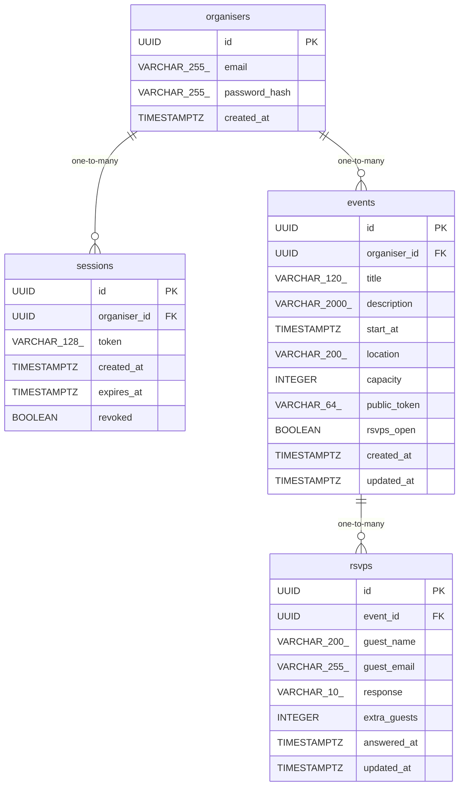

# Data Model

<!-- sdlc:auto:start entities -->
### organisers

| Field | Type | PK | FK | Nullable |
|---|---|---|---|---|
| id | UUID | True | — | False |
| email | VARCHAR(255) | False | — | False |
| password_hash | VARCHAR(255) | False | — | False |
| created_at | TIMESTAMPTZ | False | — | False |

### sessions

| Field | Type | PK | FK | Nullable |
|---|---|---|---|---|
| id | UUID | True | — | False |
| organiser_id | UUID | False | organisers.id | False |
| token | VARCHAR(128) | False | — | False |
| created_at | TIMESTAMPTZ | False | — | False |
| expires_at | TIMESTAMPTZ | False | — | False |
| revoked | BOOLEAN | False | — | False |

### events

| Field | Type | PK | FK | Nullable |
|---|---|---|---|---|
| id | UUID | True | — | False |
| organiser_id | UUID | False | organisers.id | False |
| title | VARCHAR(120) | False | — | False |
| description | VARCHAR(2000) | False | — | True |
| start_at | TIMESTAMPTZ | False | — | False |
| location | VARCHAR(200) | False | — | False |
| capacity | INTEGER | False | — | True |
| public_token | VARCHAR(64) | False | — | False |
| rsvps_open | BOOLEAN | False | — | False |
| created_at | TIMESTAMPTZ | False | — | False |
| updated_at | TIMESTAMPTZ | False | — | False |

### rsvps

| Field | Type | PK | FK | Nullable |
|---|---|---|---|---|
| id | UUID | True | — | False |
| event_id | UUID | False | events.id | False |
| guest_name | VARCHAR(200) | False | — | False |
| guest_email | VARCHAR(255) | False | — | False |
| response | VARCHAR(10) | False | — | False |
| extra_guests | INTEGER | False | — | False |
| answered_at | TIMESTAMPTZ | False | — | False |
| updated_at | TIMESTAMPTZ | False | — | False |
<!-- sdlc:auto:end entities -->

<!-- sdlc:auto:start relationships -->
| Source | Target | Type |
|---|---|---|
| organisers | sessions | one-to-many |
| organisers | events | one-to-many |
| events | rsvps | one-to-many |
<!-- sdlc:auto:end relationships -->

<!-- sdlc:auto:start er-diagram -->

<!-- sdlc:auto:end er-diagram -->
