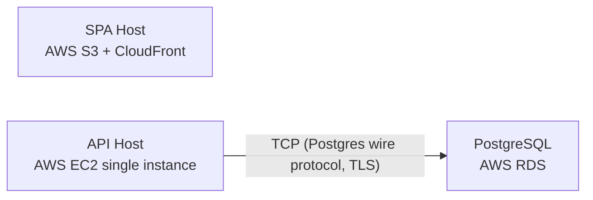

# Deployment Guide

> Maintained by QuorQ AI SDLC. Text between `sdlc:auto` markers is regenerated; anything outside them is yours and is kept.

<!-- sdlc:auto:start how-it-deploys -->
Pushes to `main` run `.github/workflows/deploy.yml`, which builds the API image (if there is a backend) and deploys the SPA to AWS Amplify. Commits touching only `docs/sdlc/**` don't deploy. Deployments can also be started from the platform's Deployment tab.
<!-- sdlc:auto:end how-it-deploys -->

<!-- sdlc:auto:start environments -->
| Name | Service | Runtime | Scaling | Environment |
|---|---|---|---|---|
| SPA Host | AWS S3 + CloudFront | Static file hosting | Single bucket, CloudFront edge-cached | dev |
| API Host | AWS EC2 single instance | Python 3.12 / uvicorn | Single small instance, no autoscaling | dev |
| PostgreSQL | AWS RDS | PostgreSQL 16 | Single db.t3.micro instance | dev |
<!-- sdlc:auto:end environments -->

<!-- sdlc:auto:start live -->
**Frontend URL:** https://pee758c0f7f82.d3j61xaup4zgrx.amplifyapp.com

**Backend URL:** https://54-201-213-100.sslip.io/apps/ee758c0f7f82/

**Database:** PostgreSQL · app

**Version:** b42597d78e66

**Commit:** `b42597d`

**Finished:** 2026-11-19
<!-- sdlc:auto:end live -->

<!-- sdlc:auto:start topology -->

<!-- sdlc:auto:end topology -->
